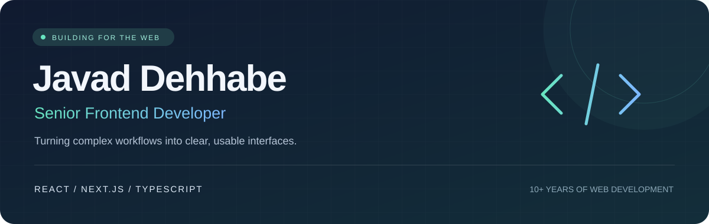

  

  <a href="https://javaddehhabe2.github.io/">Portfolio</a> &nbsp; · &nbsp;
  <a href="https://www.linkedin.com/in/javad-dehhabe-68b853289/">LinkedIn</a> &nbsp; · &nbsp;
  <a href="mailto:javad.dehhabe@gmail.com">Email me</a>

<strong>Open to remote opportunities · Iran &amp; international teams</strong>

## Hi, I'm Javad 👋

**Senior Frontend Developer · React / Next.js / TypeScript · Full stack background**

I'm a web developer with **10+ years of experience** building and maintaining e-commerce products, logistics platforms, warehouse systems, enterprise dashboards and interactive games. My background includes APIs, databases, real-time communication and municipal software.

I turn complex workflows into practical interfaces, from map-based dispatch and vehicle tracking to configurable games and data-heavy operations. I also work with **AI automation, local models and MCP servers**.

## Selected professional work

| Product / website | My contribution |
| :--- | :--- |
| **[Larqo](https://larqo.bitfinity.ir/)** | React, TypeScript, Zustand and Leaflet logistics interfaces; route planning, API integration, dispatch-point settings and vehicle-tracking timelines. |
| **[Bitfinity / WMS](https://bitfinity.ir/)** | Warehouse and operational interfaces using React, TypeScript, Ant Design and AG Grid. Application access requires sign-in. |
| **[Linari](https://linari.app/)** | Website development and contributions to warehouse-management interfaces. |
| **[Jay Warehouse](https://www.jaywarehouse.ge/)** | Website design and development for a logistics and warehousing business. |
| **[Dr Shahriari](https://drshahriari.com/)** | Design and development of a Persian e-commerce website with WordPress, WooCommerce and Elementor. |
| **[IrelandXO](https://irelandxo.com/)** | Contributed to the Drupal 7 → 9 migration at Cloudtree: theme and module rewrites, data migration and mentoring three team members. |

### Nexoland · E-commerce
**Professional contribution · Next.js / React / TypeScript**

Mobile and desktop product filtering and sorting, URL-synchronized filters and profile navigation.

### WordMasterMind & MMAPI · Configurable game platform
**Team contribution at Cloudtree · React / TypeScript / PHP / SQL / WebSockets**

Contributed to architecture and development in a 12-person team. Built multilingual gameplay, level maps, leaderboards, shared components and hooks; implemented two-player gameplay and a WebSocket server, APIs, database structures, reporting and configuration tools. The codebase targeted Android and iOS with Capacitor.

### Urban planning & municipal systems
**C# / SQL Server / Crystal Reports · Laravel / React / Leaflet / Mapbox**

Developed urban-planning and municipal-management workflows for applications, permits and property renewal, including SQL queries, stored procedures and reports. Also worked on map-based municipal activity search and filtering, plus burial-record search with periodic data imports.

Professional contributions are described according to my role. Source code is not publicly available for every project.

## AI & automation

- **n8n:** Hands-on workflow automation.
- **Ollama & AI servers:** Experience running local models and working with AI server environments.
- **MCP:** Building Model Context Protocol servers and connecting tools to AI workflows.
- **AI development tools:** ChatGPT · GitHub Copilot · Cursor · Claude · DeepSeek · OpenCode · Cline · GapGPT.

## My toolkit

| Area | Technologies |
| :--- | :--- |
| **Frontend** | React · Next.js · TypeScript · JavaScript (ES6+) · HTML · CSS |
| **State & data** | Zustand · Redux Toolkit · REST APIs · Axios · WebSockets |
| **UI** | Tailwind CSS · Ant Design · MUI · AG Grid |
| **Maps & platforms** | Leaflet · Mapbox · OSRM · PWA · Capacitor · Electron |
| **Backend & databases** | PHP · Laravel · Symfony · C# · MySQL · SQL Server · SQLite |
| **Websites & CMS** | WordPress · WooCommerce · Elementor · Drupal |
| **Automation & AI** | n8n · Ollama · AI servers · MCP server development |
| **Additional tools** | Angular · Git · GitLab · ESLint · Prettier · Crystal Reports |

## Experience at a glance

| Period | Role & focus |
| :--- | :--- |
| **2024 – Present** | **Web Developer · Mehrnik Setayesh** — Enterprise and warehouse interfaces, Next.js e-commerce, Larqo logistics, Angular POS and company websites. |
| **2019 – 2024** | **Full Stack Developer · Cloudtree** — Configurable games, multiplayer systems, APIs and databases; IrelandXO migration. |
| **2018 – 2019** | **Full Stack Developer · Anaram Pardazesh Shargh** — Urban planning and municipal systems with C#, SQL Server and Crystal Reports. |
| **2017 – 2019** | **Full Stack Developer · Atlas Smart City Communications** — Municipal applications with Laravel, React and interactive maps. |
| **2015 – 2018** | **Full Stack Developer · Parsava** — Symfony/PHP e-commerce and advertising systems, with postal, SMS and payment integrations. |

<strong>More professional work & background</strong>

- **Dakeh & Ghafaseha:** React, Redux Toolkit and Tailwind CSS applications with ad creation, search, accounts and PWA functionality.
- **POS:** Angular and TypeScript interfaces for invoices, products, customers and item/discount calculations.
- **Additional company projects:** Conference, TradLine and n8n.
- **Additional Cloudtree contributions:** GoTalk, PECS, BrainTrain, YesCar, YorCar, Thesaurus, a Three.js project and the WMN website.
- **Zaban Gostar Shadiakh Publishing:** WordPress and Elementor website design and development since 2023.
- **Education:** MSc in Computer Software, Eshragh Institute, Bojnurd.
- **Languages:** Persian (native) · English (intermediate).

<strong>درباره من | جواد ده حبه</strong>

توسعه‌دهنده ارشد فرانت‌اند با بیش از ۱۰ سال تجربه و تمرکز بر React، Next.js و TypeScript؛ با سابقه توسعه فول‌استک، فروشگاه اینترنتی، سامانه‌های انبارداری و لجستیک، رهگیری خودرو، بازی‌های تعاملی و سیستم‌های شهرسازی و مدیریت شهری.

تجربه کار با n8n، Ollama و سرورهای هوش مصنوعی، ایجاد سرورهای MCP و ابزارهایی مانند DeepSeek، OpenCode، Cline و GapGPT را دارم.

ساکن نیشابور و آماده همکاری ریموت با تیم‌های ایران و بین‌المللی در نقش توسعه‌دهنده ارشد فرانت‌اند، توسعه‌دهنده React / Next.js یا توسعه‌دهنده فول‌استک هستم.

---

### Let's build something useful.

Interested in **Senior Frontend Developer**, **React / Next.js Developer** and **Full Stack Developer** roles with remote teams.

**[View my portfolio →](https://javaddehhabe2.github.io/)** &nbsp; [Connect on LinkedIn](https://www.linkedin.com/in/javad-dehhabe-68b853289/) &nbsp; [Email me](mailto:javad.dehhabe@gmail.com)
